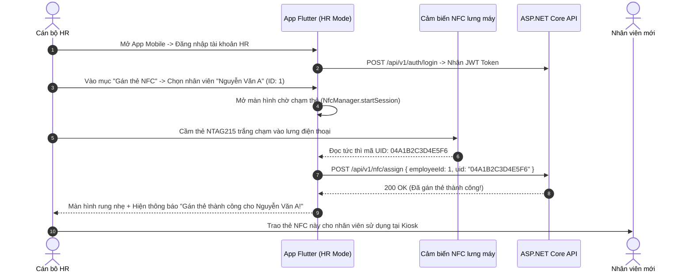
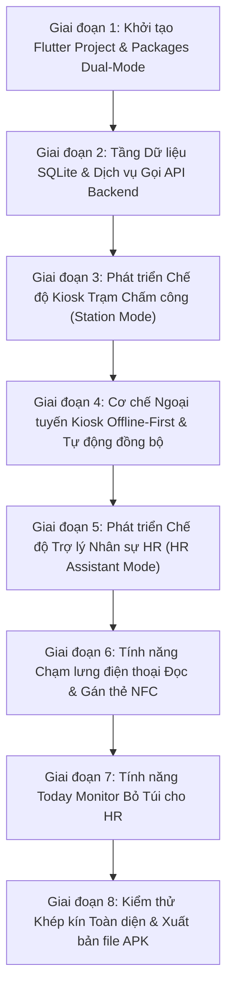

# TÀI LIỆU KIẾN TRÚC, CẤU TRÚC THƯ MỤC & LỘ TRÌNH PHÁT TRIỂN TẦNG MOBILE APP (FLUTTER DUAL-MODE)

> **Dự án**: Hệ thống Chấm công NFC Kiosk Doanh nghiệp (NFC Attendance System)  
> **Phân tầng**: Tầng 3 - Mobile App Đa Năng (Hỗ trợ Chế độ kép: **Kiosk Chấm công trạm** & **Trợ lý Quản trị Nhân sự HR**)  
> **Nền tảng công nghệ**: Flutter 3.x | Dart | `nfc_manager` | `mobile_scanner` | `sqflite` | `dio` | `flutter_dotenv` | `audioplayers` | `connectivity_plus`  
> **Backend chuẩn kết nối**: ASP.NET Core 8 Web API (`NfcAttendance` - 29 Endpoints chuẩn `/api/v1`)  
> **Ngày cập nhật**: 2026-10-31  

---

## 1. TỔNG QUAN KIẾN TRÚC DUAL-MODE (CHẾ ĐỘ KÉP)

Để tối ưu chi phí và tăng tính tiện dụng tối đa trong doanh nghiệp, ứng dụng Mobile Flutter được thiết kế theo kiến trúc **Dual-Mode (2 trong 1)**:

```
                         ┌────────────────────────────────────────┐
                         │   ỨNG DỤNG FLUTTER MOBILE CHUẨN        │
                         └───────────────────┬────────────────────┘
                                             │
                      ┌──────────────────────┴──────────────────────┐
                      ▼                                             ▼
       ┌──────────────────────────────┐              ┌──────────────────────────────┐
       │   CHẾ ĐỘ 1: KIOSK CHẤM CÔNG   │              │  CHẾ ĐỘ 2: TRỢ LÝ NHÂN SỰ HR │
       │     (Station Kiosk Mode)     │              │    (HR Mobile Assistant)     │
       ├──────────────────────────────┤              ├──────────────────────────────┤
       │ - Cài cố định trên Tablet    │              │ - Cài trên điện thoại cá nhân│
       │   ở cổng ra vào văn phòng    │              │   của cán bộ HR / Admin      │
       │ - Quẹt thẻ NFC một chạm 3s   │              │ - Dùng NFC lưng điện thoại   │
       │ - Quét Camera QR Chấm công   │              │   đọc UID & Gán thẻ cho NV   │
       │ - Phát âm thanh "Bíp"        │              │ - Khóa thẻ khi nhân viên mất │
       │ - Offline Cache SQLite       │              │ - Giám sát Today Monitor     │
       │ - Tự động đồng bộ Sync       │              │   ngay trên điện thoại       │
       └──────────────┬───────────────┘              └──────────────┬───────────────┘
                      │                                             │
                      └──────────────────────┬──────────────────────┘
                                             │ HTTPS RESTful API
                                             ▼
                      ┌────────────────────────────────────────┐
                      │    BACKEND ASP.NET CORE (.NET 8)       │
                      │   (NfcAttendance - 29 APIs Chuẩn)      │
                      └────────────────────────────────────────┘
```

---

### PHÂN HỆ 1: CHẾ ĐỘ KIOSK CHẤM CÔNG TRẠM (STATION KIOSK MODE)
- **Thiết bị**: Máy tính bảng Android / iPad đặt tại quầy lễ tân hoặc cổng xưởng.
- **Vận hành**: Chạy toàn màn hình (Kiosk Fullscreen), không cần đăng nhập tài khoản.
- **Thao tác**:
  - Nhân viên chạm thẻ NFC $\rightarrow$ App đọc UID $\rightarrow$ Gửi `POST /api/v1/attendance/check-in`.
  - Hoặc quét mã QR qua Camera.
  - Phản hồi tức thì trong **3 giây**: Phát âm thanh *"Bíp"*, hiển thị Card kết quả (Ảnh, Tên, Giờ quẹt, Trạng thái) $\rightarrow$ Tự động đóng sẵn sàng cho người tiếp theo.
  - Lưu Offline SQLite khi mất mạng $\rightarrow$ Tự động đồng bộ gói `sync-offline` khi có mạng lại.
  - Màn hình Cài đặt trạm (Device ID, URL) bảo vệ bằng mã PIN Kiosk (`888888`).

---

### PHÂN HỆ 2: CHẾ ĐỘ TRỢ LÝ NHÂN SỰ (HR ASSISTANT MODE - PHƯƠNG ÁN A)
- **Thiết bị**: Cài trực tiếp trên điện thoại thông minh (Android / iOS có NFC) của cán bộ phòng Nhân sự (HR).
- **Vận hành**: Đăng nhập bằng tài khoản Quản trị/HR (`POST /api/v1/auth/login`), lưu Token bảo mật.
- **Nghiệp vụ bỏ túi cực kỳ tiện lợi**:
  1. **Đọc UID & Gán thẻ NFC bằng điện thoại**:
     - HR không cần mua đầu đọc thẻ USB cắm máy tính.
     - HR chỉ cần mở App $\rightarrow$ Vào mục *"Cấp thẻ NFC"* $\rightarrow$ Chọn tên nhân viên $\rightarrow$ **Chạm thẻ NFC trắng vào lưng điện thoại** $\rightarrow$ App đọc mã UID và tự động gọi API `POST /api/v1/nfc/assign` gán ngay lập tức!
  2. **Khóa thẻ mất tức thì**:
     - Khi nhân viên gọi điện báo rơi thẻ, HR mở app chọn nhân viên đó và bấm nút *"Khóa thẻ"* $\rightarrow$ Gọi API `POST /api/v1/nfc/revoke` lập tức khóa thẻ trong CSDL, kẻ xấu nhặt được không thể quẹt gian lận.
  3. **Giám sát nhanh Today Monitor**:
     - HR đi công tác hay đang ăn trưa vẫn mở điện thoại xem được danh sách nhân viên đã đến công ty hôm nay (`GET /api/v1/attendance/today`).
     *(Lưu ý: Nghiệp vụ quản lý, in ấn và cấp phát mã QR được quản lý tập trung trên Web Admin để chuẩn hóa quy trình thẻ nhân viên).*

---

## 2. QUY CHUẨN BIẾN MÔI TRƯỜNG (`mobile/.env`)

```env
# URL API Backend ASP.NET Core
# Khi chạy Android Emulator: http://10.0.2.2:5000/api/v1
# Khi chạy máy thật qua WiFi LAN:
API_BASE_URL=http://192.168.1.100:5000/api/v1

# Mã định danh thiết bị Kiosk trạm mặc định
DEFAULT_DEVICE_ID=KIOSK_GATE_01

# Tên trạm Kiosk hiển thị
DEFAULT_DEVICE_NAME=Cổng Chính

# Thời gian chờ kết nối HTTP (milliseconds)
CONNECT_TIMEOUT=10000
RECEIVE_TIMEOUT=15000

# Mã PIN bảo vệ menu Kiosk
ADMIN_PIN=888888
```

---

## 3. CÂY THƯ MỤC CHUẨN HÓA DỰ ÁN MOBILE (FLUTTER)

```text
mobile/
├── assets/
│   ├── .env                             # File biến môi trường nạp lúc ứng dụng khởi chạy
│   ├── images/
│   │   ├── logo_company.png             # Logo doanh nghiệp hiển thị ở Header
│   │   ├── avatar_default.png           # Avatar mặc định
│   │   └── nfc_phone_tap.png            # Hình minh họa chạm thẻ vào lưng điện thoại HR
│   └── sounds/
│       ├── beep_success.mp3             # Âm thanh "Bíp" khi chấm công thành công
│       └── beep_error.mp3               # Âm thanh cảnh báo khi quẹt lỗi
│
├── lib/
│   ├── config/                          # Cấu hình toàn cục ứng dụng
│   │   ├── app_config.dart              # Đọc biến từ flutter_dotenv & SharedPreferences
│   │   ├── app_constants.dart           # Hằng số (Role, Chế độ Kiosk/HR, Mã lỗi)
│   │   └── app_theme.dart               # Theme màu hiện đại (Hỗ trợ cả Kiosk & HR UI)
│   │
│   ├── models/                          # Các lớp Model ánh xạ DTO Backend & SQLite
│   │   ├── tap_attendance_request.dart  # Model gửi quẹt thẻ Kiosk (cardUid, qrPayload)
│   │   ├── tap_attendance_response.dart # Model kết quả chấm công 3s (employeeCode, status, msg)
│   │   ├── sync_offline_package.dart    # Gói bản ghi offline gửi lên /attendance/sync-offline
│   │   ├── offline_attendance_record.dart# Thực thể lưu bảng SQLite cục bộ
│   │   ├── employee_model.dart          # Hồ sơ nhân viên phục vụ HR chọn gán thẻ
│   │   └── auth_model.dart              # Model đăng nhập JWT của tài khoản HR
│   │
│   ├── services/                        # Tầng Dịch vụ Xử lý Logic Cốt Lõi
│   │   ├── api_service.dart             # HTTP Client (Dio) gọi API Backend ASP.NET Core
│   │   ├── nfc_service.dart             # Lắng nghe & trích xuất mã UID thẻ NTAG215 (nfc_manager)
│   │   ├── offline_database_service.dart# Quản trị SQLite (sqflite): Offline Cache Kiosk
│   │   ├── sync_service.dart            # Tiến trình tự động đồng bộ ngoại tuyến ngầm
│   │   ├── audio_service.dart           # Phát âm thanh phản hồi Kiosk (audioplayers)
│   │   └── connectivity_service.dart    # Giám sát trạng thái mạng Online/Offline
│   │
│   ├── screens/                         # Các màn hình phân theo Chế độ Kép
│   │   ├── mode_select_screen.dart      # Màn hình chọn chế độ khi cài đặt app (Kiosk hoặc HR)
│   │   │
│   │   ├── kiosk/                       # CÁC MÀN HÌNH CHẾ ĐỘ KIOSK CHẤM CÔNG TRẠM
│   │   │   ├── kiosk_home_screen.dart   # Màn hình chờ chính quẹt thẻ NFC một chạm
│   │   │   ├── qr_scanner_screen.dart   # Màn hình Camera quét mã QR chấm công
│   │   │   ├── kiosk_settings_screen.dart# Cài đặt tham số trạm Kiosk (Device ID, Server URL)
│   │   │   └── pin_dialog.dart          # Popup nhập mã PIN 888888 khi vào cài đặt Kiosk
│   │   │
│   │   └── hr/                          # CÁC MÀN HÌNH CHẾ ĐỘ TRỢ LÝ NHÂN SỰ (HR MODE)
│   │       ├── hr_login_screen.dart     # HR đăng nhập tài khoản (Admin/HR)
│   │       ├── hr_dashboard_screen.dart # Bảng điều khiển nghiệp vụ di động của HR
│   │       ├── hr_employee_list_screen.dart # Danh sách nhân viên (tìm kiếm, chọn để gán thẻ)
│   │       ├── hr_nfc_assign_screen.dart# Màn hình chạm thẻ vào lưng điện thoại để gán thẻ
│   │       └── hr_today_monitor_screen.dart# Xem nhanh ai đã đi làm hôm nay trên điện thoại
│   │
│   ├── widgets/                         # Các thành phần giao diện dùng chung
│   │   ├── kiosk_header.dart            # Header Kiosk: Đồng hồ số đếm giây, Tên trạm, Trạng thái mạng
│   │   ├── attendance_result_modal.dart # Popup hiển thị kết quả chấm công trong 3 giây
│   │   ├── nfc_scan_animation.dart      # Hiệu ứng radar sóng NFC hướng dẫn đặt thẻ
│   │   ├── status_badge.dart            # Huy hiệu trạng thái: Đúng giờ, Trễ, Sớm, Tăng ca
│   │   └── hr_bottom_nav.dart           # Thanh điều hướng phía dưới trong chế độ HR
│   │
│   ├── utils/                           # Các hàm tiện ích
│   │   ├── date_time_utils.dart         # Format ngày giờ Việt Nam
│   │   └── dialog_utils.dart            # Hiển thị thông báo, snackbar, toast
│   │
│   └── main.dart                        # Điểm khởi động ứng dụng Flutter
│
├── .env                                 # File biến môi trường thực thi
├── .env.example                         # File mẫu biến môi trường
└── pubspec.yaml                         # Khai báo thư viện và tài nguyên
```

---

## 4. CHI TIẾT CÁC API BACKEND ĐƯỢC TÍCH HỢP TRÊN MOBILE

Ứng dụng Flutter Dual-Mode kết nối với **6 Endpoints cốt lõi** của Backend:

```
┌──────┬────────┬──────────────────────────────────┬─────────────────────────────────────────────────────────┐
│ PHÂN │ METHOD │ ENDPOINT BACKEND                 │ CHỨC NĂNG SỬ DỤNG TRÊN MOBILE APP                       │
├──────┼────────┼──────────────────────────────────┼─────────────────────────────────────────────────────────┤
│ Kiosk│ POST   │ /api/v1/attendance/check-in      │ Quẹt thẻ NFC / QR Chấm công (Vào ca / Ra ca tự động)   │
│ Kiosk│ POST   │ /api/v1/nfc/verify               │ Xác thực bảo mật thẻ NTAG215                            │
│ Kiosk│ POST   │ /api/v1/attendance/sync-offline  │ Đồng bộ gói bản ghi offline khi có mạng trở lại         │
├──────┼────────┼──────────────────────────────────┼─────────────────────────────────────────────────────────┤
│  HR  │ POST   │ /api/v1/auth/login               │ HR đăng nhập tài khoản lấy JWT Token                    │
│  HR  │ GET    │ /api/v1/employees                │ Tải danh sách nhân viên để chọn gán thẻ                 │
│  HR  │ POST   │ /api/v1/nfc/assign               │ Chạm lưng điện thoại đọc UID và gán thẻ cho nhân viên   │
│  HR  │ POST   │ /api/v1/nfc/revoke               │ Khóa/Thu hồi thẻ khi nhân viên báo mất thẻ              │
│  HR  │ GET    │ /api/v1/attendance/today         │ Xem nhanh danh sách chấm công hôm nay trên điện thoại   │
└──────┴────────┴──────────────────────────────────┴─────────────────────────────────────────────────────────┘
```

---

## 5. SƠ ĐỒ NGHIỆP VỤ: HR GÁN THẺ NFC BẰNG LƯNG ĐIỆN THOẠI (PHƯƠNG ÁN A)



---

## 6. LỘ TRÌNH THỰC HIỆN CHI TIẾT TỪNG BƯỚC (STEP-BY-STEP ROADMAP)



---

### GIAI ĐOẠN 1: KHỞI TẠO DỰ ÁN & THƯ VIỆN DUAL-MODE
- [ ] **1.1. Tạo dự án Flutter**:
  - Khởi tạo thư mục `mobile/` bằng lệnh `flutter create --org com.nfc.attendance mobile`.
  - Cài đặt đầy đủ các thư viện cho cả Kiosk và HR Mode trong `pubspec.yaml`:
    ```yaml
    dependencies:
      flutter:
        sdk: flutter
      flutter_dotenv: ^5.1.0        # Đọc biến môi trường .env
      dio: ^5.4.0                   # Gọi RESTful API Backend
      nfc_manager: ^3.3.0           # Đọc/Ghi thẻ NFC NTAG215
      mobile_scanner: ^5.1.1        # Camera quét mã QR chấm công Kiosk
      sqflite: ^2.3.2               # CSDL SQLite cục bộ cho offline cache Kiosk
      path_provider: ^2.1.2         # Đường dẫn bộ nhớ cục bộ
      audioplayers: ^6.0.0          # Phát âm thanh phản hồi Kiosk
      connectivity_plus: ^6.0.3     # Giám sát trạng thái mạng Online/Offline
      shared_preferences: ^2.2.2    # Lưu cấu hình chế độ Kiosk/HR và Token
      intl: ^0.19.0                 # Định dạng ngày giờ chuẩn Việt Nam
    ```
- [ ] **1.2. Cấu hình Biến môi trường (`mobile/assets/.env`)**:
  - Tạo file `.env` và khai báo `API_BASE_URL`, `DEFAULT_DEVICE_ID`, `ADMIN_PIN`.

---

### GIAI ĐOẠN 2: TẦNG DỮ LIỆU & HTTP API CLIENT
- [ ] **2.1. Tầng SQLite Offline Cache (`offline_database_service.dart`)**:
  - Quản trị bảng `offline_attendances`: lưu trữ quẹt thẻ khi Kiosk mất mạng.
- [ ] **2.2. Xây dựng HTTP Client (`api_service.dart`)**:
  - Cấu hình `Dio` Interceptor tự động gắn Bearer Token khi đang ở chế độ HR.
  - Viết đầy đủ 6 phương thức API: `checkIn()`, `verifyCard()`, `syncOffline()`, `login()`, `getEmployees()`, `assignNfc()`, `revokeNfc()`, `getTodayAttendance()`.

---

### GIAI ĐOẠN 3: PHÁT TRIỂN CHẾ ĐỘ KIOSK TRẠM CHẤM CÔNG (STATION MODE)
- [ ] **3.1. Màn hình Chờ Quẹt Thẻ NFC (`kiosk_home_screen.dart`)**:
  - Đồng hồ số đếm giây thực tế, hiệu ứng radar sóng NFC động.
  - Tự động bắt sự kiện thẻ NFC NTAG215 chạm vào máy tính bảng $\rightarrow$ Gọi API `check-in`.
- [ ] **3.2. Màn hình Quét Camera QR Chấm công (`qr_scanner_screen.dart`)**:
  - Khung ngắm Camera tốc độ cao, quét mã QR trên điện thoại/thẻ của nhân viên.
- [ ] **3.3. Dialog Phản hồi Kiosk 3 Giây & Âm thanh**:
  - Phát âm thanh *"Bíp"* (thành công) hoặc cảnh báo (lỗi).
  - Card toàn màn hình hiện ảnh nhân viên, tên, giờ quẹt, trạng thái $\rightarrow$ Đếm lùi 3 giây tự động đóng.

---

### GIAI ĐOẠN 4: CƠ CHẾ KIOSK NGOẠI TUYẾN & TỰ ĐỘNG ĐỒNG BỘ (OFFLINE-FIRST)
- [ ] **4.1. Ghi nhận Offline**: Khi mất mạng, lưu ngay bản ghi vào SQLite (`is_synced = 0`).
- [ ] **4.2. Tự động Đồng bộ Ngầm (`sync_service.dart`)**:
  - Khi có mạng trở lại, tự động gom bản ghi gửi `POST /api/v1/attendance/sync-offline` và đánh dấu `is_synced = 1`.
- [ ] **4.3. Màn hình Cài đặt Trạm Kiosk (`kiosk_settings_screen.dart`)**:
  - Bảo vệ bằng mã PIN `888888`, cho phép đổi Server URL, Device ID.

---

### GIAI ĐOẠN 5: PHÁT TRIỂN CHẾ ĐỘ TRỢ LÝ NHÂN SỰ HR (HR ASSISTANT MODE)
- [ ] **5.1. Màn hình Đăng nhập HR (`hr_login_screen.dart`)**:
  - Đăng nhập tài khoản Admin/HR qua `POST /api/v1/auth/login`, lưu JWT Token.
- [ ] **5.2. Màn hình Dashboard HR (`hr_dashboard_screen.dart`)**:
  - Giao diện thân thiện gồm 3 chức năng chính:
    1. *Cấp thẻ NFC mới (chạm lưng điện thoại)*
    2. *Khóa/Thu hồi thẻ mất*
    3. *Xem Today Monitor bỏ túi*

---

### GIAI ĐOẠN 6: TÍNH NĂNG CHẠM LƯNG ĐIỆN THOẠI ĐỌC & GÁN THẺ NFC
- [ ] **6.1. Màn hình Danh sách Nhân viên (`hr_employee_list_screen.dart`)**:
  - Tải danh sách nhân viên từ `GET /api/v1/employees`, tìm kiếm nhanh theo mã hoặc tên.
- [ ] **6.2. Màn hình Quét Thẻ Lưng Máy (`hr_nfc_assign_screen.dart`)**:
  - Kích hoạt cảm biến NFC điện thoại HR.
  - Hình ảnh minh họa hướng dẫn HR: *"Vui lòng chạm thẻ NFC trắng vào lưng điện thoại"*.
  - Khi bắt được UID: Tự động gọi `POST /api/v1/nfc/assign` gán cho nhân viên đã chọn $\rightarrow$ Rung máy (Haptic Feedback) và hiển thị thông báo thành công!
- [ ] **6.3. Tính năng Khóa Thẻ Mất**:
  - HR chọn nhân viên báo mất thẻ $\rightarrow$ Bấm nút *"Khóa thẻ"* $\rightarrow$ Gọi `POST /api/v1/nfc/revoke`.

---

### GIAI ĐOẠN 7: TÍNH NĂNG TODAY MONITOR BỎ TÚI CHO HR
- [ ] **7.1. Màn hình Today Monitor Bỏ Túi (`hr_today_monitor_screen.dart`)**:
  - Xem danh sách nhân viên đã chấm công hôm nay trực tiếp trên điện thoại HR (`GET /api/v1/attendance/today`).
  - Hỗ trợ lọc nhanh theo phòng ban, tìm kiếm theo tên hoặc mã nhân viên.
  - Thống kê nhanh số người đã đến làm việc trong ngày.

---

### GIAI ĐOẠN 8: KIỂM THỬ KHÉP KÍN TOÀN HỆ THỐNG & ĐÓNG GÓI
- [ ] **8.1. Kiểm thử Kịch bản Thực tế Khép kín**:
  1. HR dùng điện thoại chạm thẻ NFC trắng gán cho nhân viên A.
  2. Nhân viên A cầm thẻ ra máy Kiosk ở cổng quẹt chấm công.
  3. Máy Kiosk nhận diện thành công, phát tiếng *"Bíp"*, hiện tên nhân viên A.
  4. Màn hình máy tính Web Admin của Ban giám đốc tự động nhảy dòng mới qua SignalR.
- [ ] **8.2. Xuất bản file APK Release**:
  - Chạy `flutter build apk --release` tạo file `app-release.apk` sẵn sàng cài đặt cho cả máy Kiosk trạm và điện thoại của cán bộ HR.

---
*Tài liệu này xác lập tiêu chuẩn thiết kế và lộ trình kỹ thuật chính thức cho phân hệ Mobile App Flutter Dual-Mode của dự án NFC Attendance.*
