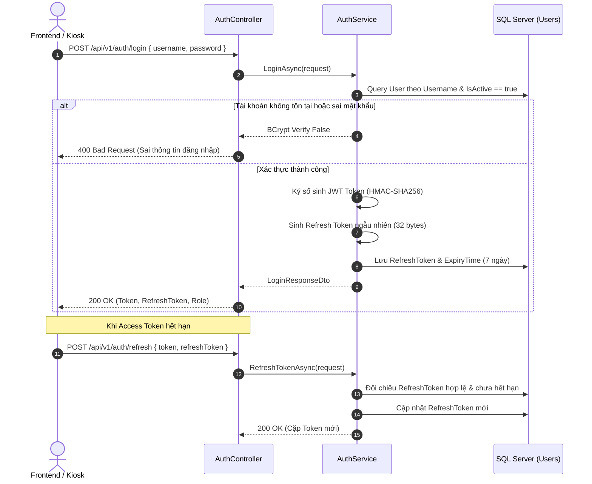
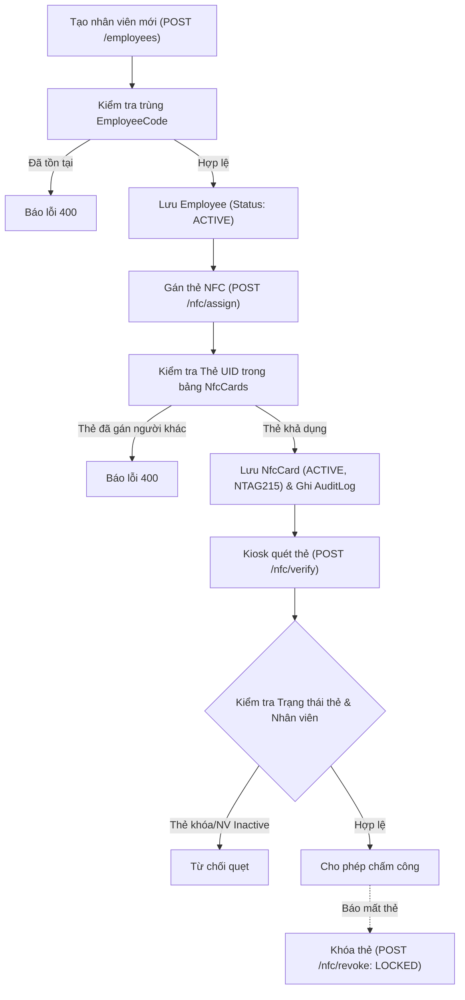
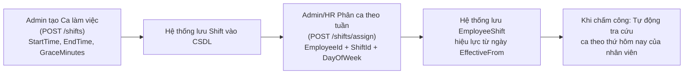
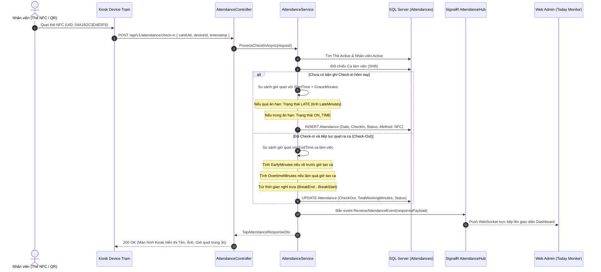
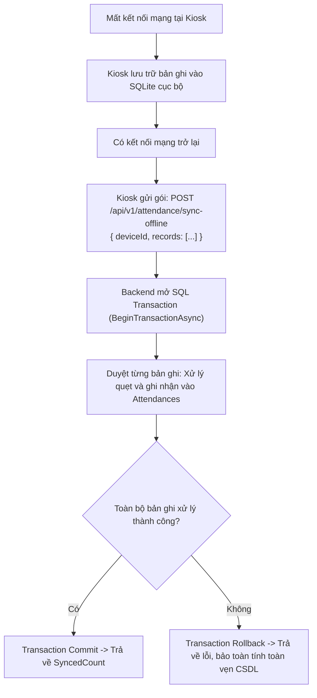
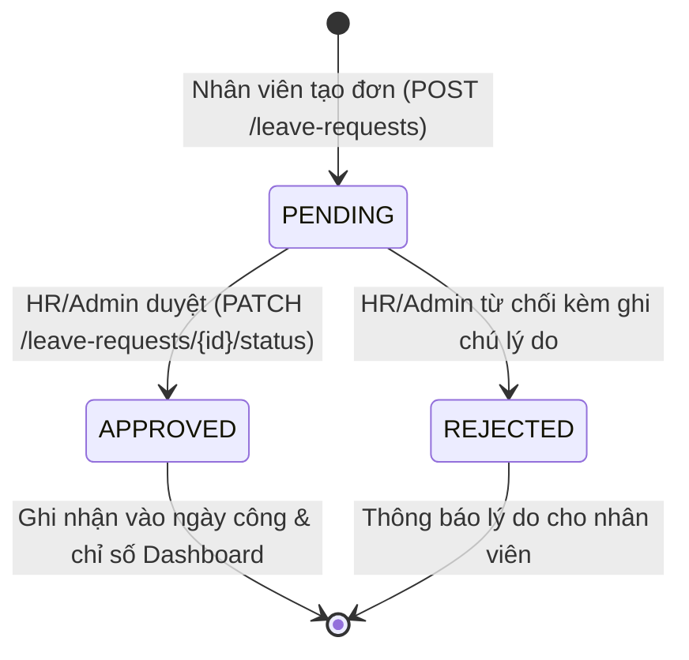
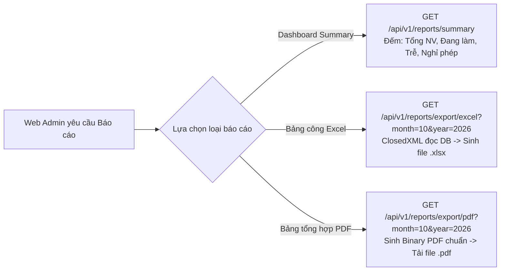

# TÀI LIỆU KIỂM TRA & ĐẶC TẢ CHI TIẾT 27 API VÀ LUỒNG HOẠT ĐỘNG (CHECK.MD)

> **Hệ thống**: NFC Attendance System (Hệ thống Chấm công NFC Kiosk Doanh nghiệp)  
> **Nền tảng**: ASP.NET Core 8 Web API | Entity Framework Core 8 | Microsoft SQL Server | SignalR  
> **Database**: `Server=HIRVY\SQLEXPRESS;Database=Nhom12_CT4;Trusted_Connection=True;TrustServerCertificate=True`  
> **Thời gian cập nhật**: 2026-10-30  

---

## 1. BẢNG TỔNG HỢP DANH MỤC 27 ENDPOINT API

| STT | Phương thức | Endpoint API | Nhóm chức năng | Tóm tắt chức năng | Quyền hạn truy cập |
|:---:|:-----------:|:-------------|:---------------|:------------------|:------------------:|
| **1** | `POST` | `/api/v1/auth/login` | Nhóm A (Auth) | Đăng nhập hệ thống, cấp Access Token & Refresh Token | Public |
| **2** | `POST` | `/api/v1/auth/refresh` | Nhóm A (Auth) | Cấp mới JWT Token khi token cũ hết hạn | Public |
| **3** | `GET` | `/api/v1/auth/me` | Nhóm A (Auth) | Lấy thông tin tài khoản đang đăng nhập | Bearer Token |
| **4** | `GET` | `/api/v1/employees` | Nhóm B (Nhân sự) | Danh sách nhân viên (phân trang, tìm kiếm, lọc phòng ban) | `ADMIN`, `HR` |
| **5** | `POST` | `/api/v1/employees` | Nhóm B (Nhân sự) | Thêm mới hồ sơ nhân sự | `ADMIN`, `HR` |
| **6** | `PUT` | `/api/v1/employees/{id}` | Nhóm B (Nhân sự) | Cập nhật thông tin nhân viên theo ID | `ADMIN`, `HR` |
| **7** | `DELETE` | `/api/v1/employees/{id}` | Nhóm B (Nhân sự) | Vô hiệu hóa nhân viên (chuyển sang `INACTIVE`) | `ADMIN`, `HR` |
| **8** | `POST` | `/api/v1/nfc/assign` | Nhóm B (Thẻ NFC) | Gán thẻ NTAG215 UID cho một nhân viên | `ADMIN`, `HR` |
| **9** | `POST` | `/api/v1/nfc/revoke` | Nhóm B (Thẻ NFC) | Khóa/Thu hồi thẻ NFC khi báo mất hoặc đổi thẻ | `ADMIN`, `HR` |
| **10** | `POST` | `/api/v1/nfc/verify` | Nhóm B (Thẻ NFC) | Xác thực tính hợp lệ và an toàn của thẻ NFC | `KIOSK`, `ADMIN` |
| **11** | `GET` | `/api/v1/shifts` | Nhóm C (Ca làm) | Lấy danh mục tất cả ca làm việc đang hoạt động | `ADMIN`, `HR` |
| **12** | `POST` | `/api/v1/shifts` | Nhóm C (Ca làm) | Khai báo ca làm việc mới | `ADMIN` |
| **13** | `PUT` | `/api/v1/shifts/{id}` | Nhóm C (Ca làm) | Chỉnh sửa khung giờ và thời gian ân hạn của ca | `ADMIN` |
| **14** | `DELETE` | `/api/v1/shifts/{id}` | Nhóm C (Ca làm) | Ngừng kích hoạt một ca làm việc | `ADMIN` |
| **15** | `POST` | `/api/v1/shifts/assign` | Nhóm C (Phân ca) | Phân ca làm việc theo tuần cho nhân sự | `ADMIN`, `HR` |
| **16** | `POST` | `/api/v1/attendance/check-in` | Nhóm D (Chấm công) | Quẹt thẻ/QR Check-In vào ca; bắn SignalR realtime | `KIOSK`, `ADMIN` |
| **17** | `POST` | `/api/v1/attendance/check-out` | Nhóm D (Chấm công) | Quẹt thẻ/QR Check-Out ra ca; tính giờ làm & tăng ca | `KIOSK`, `ADMIN` |
| **18** | `GET` | `/api/v1/attendance/today` | Nhóm D (Chấm công) | Danh sách dữ liệu chấm công hôm nay (Today Monitor) | Mọi người dùng |
| **19** | `GET` | `/api/v1/attendance/history` | Nhóm D (Chấm công) | Lịch sử chấm công (lọc ngày, phòng ban, nhân viên) | `ADMIN`, `HR` |
| **20** | `POST` | `/api/v1/attendance/manual` | Nhóm D (Chấm công) | Chỉnh sửa/bù công thủ công khi quên quẹt thẻ | `ADMIN`, `HR` |
| **21** | `POST` | `/api/v1/attendance/sync-offline` | Nhóm D (Chấm công) | Đồng bộ hàng loạt bản ghi chấm công từ Kiosk ngoại tuyến | `KIOSK`, `ADMIN` |
| **22** | `GET` | `/api/v1/leave-requests` | Nhóm E (Nghỉ phép) | Danh sách đơn xin nghỉ (lọc `PENDING`, `APPROVED`, `REJECTED`) | `ADMIN`, `HR` |
| **23** | `POST` | `/api/v1/leave-requests` | Nhóm E (Nghỉ phép) | Tạo đơn xin nghỉ phép mới | Mọi người dùng |
| **24** | `PATCH` | `/api/v1/leave-requests/{id}/status` | Nhóm E (Nghỉ phép) | Phê duyệt hoặc từ chối đơn nghỉ phép kèm ghi chú | `ADMIN`, `HR` |
| **25** | `GET` | `/api/v1/reports/summary` | Nhóm F (Báo cáo) | 4 chỉ số thống kê Dashboard (Tổng NV, Đang làm, Trễ, Nghỉ) | `ADMIN`, `HR` |
| **26** | `GET` | `/api/v1/reports/export/excel` | Nhóm F (Báo cáo) | Xuất bảng công chi tiết ra file Excel (`.xlsx`) | `ADMIN`, `HR` |
| **27** | `GET` | `/api/v1/reports/export/pdf` | Nhóm F (Báo cáo) | Xuất báo cáo tổng hợp chấm công ra file PDF (`.pdf`) | `ADMIN`, `HR` |

---

## 2. CHI TIẾT ĐẶC TẢ TỪNG API

### NHÓM A: XÁC THỰC & PHÂN QUYỀN (`/api/v1/auth`)

#### 1. Đăng nhập hệ thống (`POST /api/v1/auth/login`)
- **Mục đích**: Xác thực người dùng (Admin, HR, Kiosk) qua Username & Mật khẩu băm BCrypt. Trả về JWT Access Token (hạn 7 ngày) và chuỗi Refresh Token ngẫu nhiên an toàn.
- **Request Body**:
  ```json
  {
    "username": "admin",
    "password": "Admin@123"
  }
  ```
- **Response (200 OK)**:
  ```json
  {
    "success": true,
    "message": "Đăng nhập thành công!",
    "token": "eyJhbGciOiJIUzI1NiIsInR5cCI...",
    "refreshToken": "g8Hj71...==",
    "username": "admin",
    "role": "ADMIN"
  }
  ```

#### 2. Cấp lại Token (`POST /api/v1/auth/refresh`)
- **Mục đích**: Tự động gia hạn Access Token mới bằng Refresh Token khi Access Token hết hạn mà người dùng không cần đăng nhập lại.
- **Request Body**:
  ```json
  {
    "token": "eyJhbGciOiJIUzI1NiIsInR5cCI...",
    "refreshToken": "g8Hj71...=="
  }
  ```
- **Response (200 OK)**:
  ```json
  {
    "success": true,
    "message": "Cấp mới token thành công!",
    "token": "eyJhbGciOiJIUzI1NiIsInR5cCI...",
    "refreshToken": "x9Jk22...==",
    "username": "admin",
    "role": "ADMIN"
  }
  ```

#### 3. Lấy thông tin tài khoản hiện hành (`GET /api/v1/auth/me`)
- **Mục đích**: Giải mã Claims từ Bearer Token để lấy ID, Username, Vai trò và thời gian tạo tài khoản.
- **Header**: `Authorization: Bearer {token}`
- **Response (200 OK)**:
  ```json
  {
    "success": true,
    "data": {
      "id": 1,
      "username": "admin",
      "role": "ADMIN",
      "isActive": true,
      "createdAt": "2026-10-30T20:00:00"
    }
  }
  ```

---

### NHÓM B: QUẢN LÝ NHÂN SỰ & THẺ NFC (`/api/v1/employees` & `/api/v1/nfc`)

#### 4. Danh sách nhân viên (`GET /api/v1/employees`)
- **Query Params**:
  - `pageIndex` (mặc định: 1)
  - `pageSize` (mặc định: 10)
  - `department` (tùy chọn: Phòng Kỹ thuật, Phòng Kế toán...)
  - `search` (tìm theo mã NV, họ tên, email, sđt)
- **Response (200 OK)**:
  ```json
  {
    "success": true,
    "data": {
      "items": [
        {
          "id": 1,
          "employeeCode": "NV001",
          "fullName": "Nguyễn Văn A",
          "phone": "0912345678",
          "email": "a.nguyen@company.com",
          "department": "Phòng Kỹ thuật",
          "position": "Kỹ sư phần mềm",
          "avatarUrl": null,
          "status": "ACTIVE",
          "createdAt": "2026-10-30T20:00:00",
          "nfcCardUids": ["04A1B2C3D4E5F6"]
        }
      ],
      "totalCount": 1,
      "pageIndex": 1,
      "pageSize": 10,
      "totalPages": 1
    }
  }
  ```

#### 5. Thêm nhân viên mới (`POST /api/v1/employees`)
- **Request Body**:
  ```json
  {
    "employeeCode": "NV002",
    "fullName": "Trần Thị B",
    "phone": "0987654321",
    "email": "b.tran@company.com",
    "department": "Phòng Kế toán",
    "position": "Chuyên viên kế toán",
    "avatarUrl": null
  }
  ```
- **Response (200 OK)**:
  ```json
  {
    "success": true,
    "message": "Thêm nhân viên thành công!",
    "data": {
      "id": 2,
      "employeeCode": "NV002",
      "fullName": "Trần Thị B",
      "status": "ACTIVE"
    }
  }
  ```

#### 6. Chỉnh sửa hồ sơ nhân viên (`PUT /api/v1/employees/{id}`)
- **Request Body**:
  ```json
  {
    "fullName": "Trần Thị B (Đã cập nhật)",
    "phone": "0987654321",
    "email": "b.tran@company.com",
    "department": "Phòng Kế toán",
    "position": "Kế toán trưởng",
    "avatarUrl": null,
    "status": "ACTIVE"
  }
  ```

#### 7. Vô hiệu hóa nhân viên (`DELETE /api/v1/employees/{id}`)
- **Mục đích**: Soft-delete, chuyển `Status` thành `INACTIVE` để bảo toàn lịch sử chấm công.
- **Response (200 OK)**:
  ```json
  {
    "success": true,
    "message": "Đã chuyển trạng thái nhân viên NV002 sang INACTIVE."
  }
  ```

#### 8. Gán thẻ NFC cho nhân viên (`POST /api/v1/nfc/assign`)
- **Mục đích**: Liên kết UID thẻ NTAG215 với nhân viên, tự động ghi AuditLog.
- **Request Body**:
  ```json
  {
    "employeeId": 1,
    "uid": "04A1B2C3D4E5F6",
    "cardType": "NTAG215"
  }
  ```

#### 9. Thu hồi hoặc khóa thẻ NFC (`POST /api/v1/nfc/revoke`)
- **Mục đích**: Khóa thẻ (`Status = "LOCKED"`) khi nhân viên báo mất thẻ, ngăn kẻ xấu quẹt gian lận.
- **Request Body**:
  ```json
  {
    "cardUid": "04A1B2C3D4E5F6",
    "reason": "Nhân viên làm rơi thẻ"
  }
  ```

#### 10. Xác thực thẻ NFC bảo mật (`POST /api/v1/nfc/verify`)
- **Mục đích**: Kiểm tra thẻ tồn tại, thẻ đang `ACTIVE`, nhân viên sở hữu đang `ACTIVE` và kiểm tra khóa PWD/PACK phần cứng.
- **Request Body**:
  ```json
  {
    "cardUid": "04A1B2C3D4E5F6",
    "password": null,
    "pack": null
  }
  ```
- **Response (200 OK)**:
  ```json
  {
    "isValid": true,
    "message": "Thẻ NFC NTAG215 hợp lệ và bảo mật an toàn.",
    "employeeCode": "NV001",
    "fullName": "Nguyễn Văn A",
    "cardStatus": "ACTIVE"
  }
  ```

---

### NHÓM C: CA LÀM VIỆC & PHÂN CA (`/api/v1/shifts`)

#### 11. Danh sách ca làm việc (`GET /api/v1/shifts`)
- **Response (200 OK)**:
  ```json
  {
    "success": true,
    "data": [
      {
        "id": 1,
        "name": "Ca Hành Chính",
        "startTime": "08:00:00",
        "endTime": "17:30:00",
        "breakStart": "12:00:00",
        "breakEnd": "13:30:00",
        "graceMinutes": 15,
        "isActive": true
      }
    ]
  }
  ```

#### 12. Tạo ca làm việc mới (`POST /api/v1/shifts`)
- **Request Body**:
  ```json
  {
    "name": "Ca Sáng",
    "startTime": "06:00:00",
    "endTime": "14:00:00",
    "breakStart": "11:30:00",
    "breakEnd": "12:30:00",
    "graceMinutes": 10
  }
  ```

#### 13. Cập nhật ca làm việc (`PUT /api/v1/shifts/{id}`)
- **Request Body**: Chỉnh sửa khung giờ làm việc và thời gian ân hạn.

#### 14. Xóa ca làm việc (`DELETE /api/v1/shifts/{id}`)
- **Mục đích**: Chuyển `IsActive = false`.

#### 15. Phân ca làm việc theo tuần (`POST /api/v1/shifts/assign`)
- **Mục đích**: Gán ca cho nhân viên theo các thứ trong tuần (`0`: Chủ Nhật, `1`: Thứ Hai, ..., `6`: Thứ Bảy).
- **Request Body**:
  ```json
  {
    "employeeId": 1,
    "shiftId": 1,
    "dayOfWeek": 1,
    "effectiveFrom": "2026-11-01",
    "effectiveTo": "2026-12-31"
  }
  ```

---

### NHÓM D: CHẤM CÔNG & XỬ LÝ KIOSK (`/api/v1/attendance`)

#### 16. Ghi nhận vào ca - Check-In (`POST /api/v1/attendance/check-in`)
- **Mục đích**: Nhận lượt quét thẻ/QR, tự động tính số phút trễ theo ca & ân hạn (`GraceMinutes`), lưu DB và phát sự kiện realtime SignalR `ReceiveAttendanceEvent`.
- **Request Body**:
  ```json
  {
    "cardUid": "04A1B2C3D4E5F6",
    "qrPayload": null,
    "checkInMethod": "NFC",
    "deviceId": "KIOSK_GATE_01",
    "timestamp": "2026-10-30T08:05:00"
  }
  ```
- **Response (200 OK)**:
  ```json
  {
    "success": true,
    "action": "CHECK_IN",
    "employeeCode": "NV001",
    "fullName": "Nguyễn Văn A",
    "department": "Phòng Kỹ thuật",
    "avatarUrl": null,
    "timestamp": "2026-10-30T08:05:00",
    "status": "ON_TIME",
    "message": "Check-in thành công (Đúng giờ)"
  }
  ```

#### 17. Ghi nhận ra ca - Check-Out (`POST /api/v1/attendance/check-out`)
- **Mục đích**: Ghi nhận giờ về, tính `EarlyMinutes` (về sớm), `OvertimeMinutes` (tăng ca), trừ thời gian nghỉ trưa (`BreakEnd - BreakStart`) và tính `TotalWorkingMinutes`.
- **Request Body**:
  ```json
  {
    "cardUid": "04A1B2C3D4E5F6",
    "checkInMethod": "NFC",
    "deviceId": "KIOSK_GATE_01",
    "timestamp": "2026-10-30T17:45:00"
  }
  ```
- **Response (200 OK)**:
  ```json
  {
    "success": true,
    "action": "CHECK_OUT",
    "employeeCode": "NV001",
    "fullName": "Nguyễn Văn A",
    "department": "Phòng Kỹ thuật",
    "timestamp": "2026-10-30T17:45:00",
    "status": "OVERTIME",
    "message": "Check-out thành công (Tổng làm việc: 8h15p)"
  }
  ```

#### 18. Giám sát dữ liệu hôm nay - Today Monitor (`GET /api/v1/attendance/today`)
- **Mục đích**: Trả về toàn bộ lượt chấm công trong ngày của doanh nghiệp để hiển thị bảng trạng thái trực tiếp trên màn hình quản trị.
- **Response (200 OK)**: Danh sách bản ghi chấm công kèm trạng thái, giờ Check-In, giờ Check-Out, số phút trễ/sớm.

#### 19. Lịch sử chấm công (`GET /api/v1/attendance/history`)
- **Query Params**: `fromDate`, `toDate`, `department`, `employeeId`.
- **Response (200 OK)**: Lịch sử chi tiết các ngày công theo tiêu chí lọc.

#### 20. Điều chỉnh công thủ công (`POST /api/v1/attendance/manual`)
- **Mục đích**: Quản trị viên/HR sửa hoặc tạo mới giờ vào/ra khi nhân viên quên quẹt thẻ.
- **Request Body**:
  ```json
  {
    "employeeId": 1,
    "date": "2026-10-30",
    "checkIn": "2026-10-30T08:00:00",
    "checkOut": "2026-10-30T17:30:00",
    "status": "COMPLETED"
  }
  ```

#### 21. Tiếp nhận gói chấm công ngoại tuyến - Sync Offline (`POST /api/v1/attendance/sync-offline`)
- **Mục đích**: Trạm Kiosk khi bị mất mạng lưu trữ cục bộ, khi có mạng trở lại gửi gói danh sách bản ghi; Backend xử lý Bulk Insert an toàn trong một SQL Transaction (Rollback nếu lỗi).
- **Request Body**:
  ```json
  {
    "deviceId": "KIOSK_GATE_01",
    "records": [
      {
        "cardUid": "04A1B2C3D4E5F6",
        "checkInMethod": "NFC",
        "timestamp": "2026-10-30T07:55:00"
      }
    ]
  }
  ```
- **Response (200 OK)**:
  ```json
  {
    "success": true,
    "syncedCount": 1,
    "message": "Đồng bộ thành công 1/1 bản ghi vào hệ thống!"
  }
  ```

---

### NHÓM E: ĐƠN NGHỈ PHÉP (`/api/v1/leave-requests`)

#### 22. Danh sách đơn xin nghỉ phép (`GET /api/v1/leave-requests`)
- **Query Params**: `status` (tùy chọn: `PENDING`, `APPROVED`, `REJECTED`).
- **Response (200 OK)**: Danh sách đơn nghỉ, nhân viên xin nghỉ, loại phép, khoảng ngày, người duyệt và ghi chú.

#### 23. Gửi đơn xin nghỉ phép (`POST /api/v1/leave-requests`)
- **Request Body**:
  ```json
  {
    "employeeId": 1,
    "leaveType": "ANNUAL",
    "startDate": "2026-11-05",
    "endDate": "2026-11-06",
    "totalDays": 2.0,
    "reason": "Giải quyết công việc gia đình"
  }
  ```

#### 24. Phê duyệt hoặc từ chối đơn (`PATCH /api/v1/leave-requests/{id}/status`)
- **Request Body**:
  ```json
  {
    "status": "APPROVED",
    "note": "Đồng ý phê duyệt nghỉ phép."
  }
  ```

---

### NHÓM F: BÁO CÁO & THỐNG KÊ (`/api/v1/reports`)

#### 25. Thống kê tổng quan Dashboard (`GET /api/v1/reports/summary`)
- **Response (200 OK)**:
  ```json
  {
    "success": true,
    "data": {
      "totalEmployees": 45,
      "attendedToday": 38,
      "lateToday": 3,
      "onLeaveToday": 2
    }
  }
  ```

#### 26. Xuất bảng công chi tiết ra file Excel (`GET /api/v1/reports/export/excel?month=10&year=2026`)
- **Output**: File Excel nhị phân `.xlsx` (MIME: `application/vnd.openxmlformats-officedocument.spreadsheetml.sheet`) được sinh qua thư viện `ClosedXML`, định dạng bảng kẻ viền, tiêu đề màu xanh chuyên nghiệp.

#### 27. Xuất báo cáo tổng hợp chấm công ra file PDF (`GET /api/v1/reports/export/pdf?month=10&year=2026`)
- **Output**: File PDF chuẩn nhị phân (MIME: `application/pdf`) theo chuẩn PDF-1.4, tổng hợp số lượt công, số lượt trễ, tổng số giờ làm và danh sách chi tiết các lượt chấm công trong tháng.

---

## 3. CÁC LUỒNG HOẠT ĐỘNG NGHIỆP VỤ (BUSINESS WORKFLOWS)

### LUỒNG 1: XÁC THỰC & CẤP PHÁT TOKEN (AUTHENTICATION WORKFLOW)



---

### LUỒNG 2: VÒNG ĐỜI HỒ SƠ & THẺ NFC NTAG215 (EMPLOYEE & NFC LIFECYCLE)



---

### LUỒNG 3: THIẾT LẬP CA VÀ PHÂN CA TUẦN (SHIFT ROSTER WORKFLOW)



---

### LUỒNG 4: CHẤM CÔNG KIOSK TRỰC TUYẾN & SIGNALR REALTIME (KIOSK ATTENDANCE)



---

### LUỒNG 5: ĐỒNG BỘ CHẤM CÔNG NGOẠI TUYẾN (OFFLINE SYNC TRANSACTION)



---

### LUỒNG 6: QUY TRÌNH NỘP & PHÊ DUYỆT ĐƠN NGHỈ PHÉP (LEAVE REQUEST WORKFLOW)



---

### LUỒNG 7: TỔNG HỢP BÁO CÁO & XUẤT DỮ LIỆU EXCEL / PDF (REPORTING WORKFLOW)



---

## 4. HƯỚNG DẪN KIỂM THỬ TRÊN SWAGGER UI

1. **Khởi động ứng dụng Backend**:
   ```powershell
   cd d:\vsXanh\appchamcongnhanvien\NfcAttendance
   dotnet run
   ```
2. **Truy cập Swagger**:
   Mở trình duyệt: `http://localhost:5000/swagger` hoặc cổng HTTPS được cấu hình trong `launchSettings.json`.
3. **Đăng nhập lấy Token**:
   - Gọi `POST /api/v1/auth/login` với:
     ```json
     {
       "username": "admin",
       "password": "Admin@123"
     }
     ```
   - Sao chép chuỗi `token` trong kết quả trả về.
4. **Ủy quyền Swagger**:
   - Nhấn nút **Authorize** (hình ổ khóa góc trên bên phải màn hình Swagger).
   - Nhập: `Bearer {token_vừa_sao_chép}` và bấm **Authorize**.
5. **Kiểm thử các API nghiệp vụ**:
   - `GET /api/v1/auth/me`
   - `GET /api/v1/employees`
   - `POST /api/v1/attendance/check-in` với UID mẫu `04A1B2C3D4E5F6`
   - `GET /api/v1/attendance/today`
   - `GET /api/v1/reports/summary`
   - `GET /api/v1/reports/export/excel?month=10&year=2026`
   - `GET /api/v1/reports/export/pdf?month=10&year=2026`

