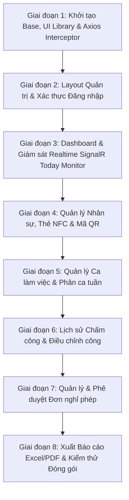

# TÀI LIỆU KIẾN TRÚC, CẤU TRÚC THƯ MỤC & LỘ TRÌNH PHÁT TRIỂN TẦNG FRONTEND (REACT.JS)

> **Dự án**: Hệ thống Chấm công NFC Kiosk Doanh nghiệp (NFC Attendance System)  
> **Phân tầng**: Tầng 4 - Frontend Web Quản trị (Web Admin Portal)  
> **Nền tảng công nghệ**: React 18+ | Vite | Tailwind CSS | React Router v6 | Axios | SignalR Client (`@microsoft/signalr`) | Lucide React | Recharts | QRCode.react  
> **Backend chuẩn kết nối**: ASP.NET Core 8 Web API (`NfcAttendance` - 29 Endpoints chuẩn `/api/v1`)  
> **Ngày lập kế hoạch**: 2026-10-31  

---

## 1. TỔNG QUAN HỆ THỐNG FRONTEND WEB QUẢN TRỊ

Frontend Web Quản trị là cổng thông tin trung tâm dành cho **Ban Giám Đốc**, **Phòng Nhân Sự (HR)** và **Quản trị viên hệ thống (Admin)** nhằm quản lý toàn diện các hoạt động nhân sự và chấm công trong doanh nghiệp:

1. **Xác thực bảo mật**: Quản lý phiên làm việc qua JWT Bearer Token, cơ chế tự động gia hạn token ngầm (Silent Refresh Token Interceptor), kiểm soát phân quyền Role-Based Access Control (`ADMIN`, `HR`).
2. **Giám sát thời gian thực (Today Monitor - Realtime Push)**: Kết nối trực tiếp với Backend qua giao thức WebSocket (SignalR). Khi nhân viên quẹt thẻ NFC hoặc quét mã QR tại máy Kiosk, bảng Today Monitor trên trình duyệt tự động chèn dòng mới, cập nhật giờ ra/vào và phát âm thanh thông báo nhẹ mà không cần nhấn F5.
3. **Quản lý Nhân sự & Cấp phát Thẻ NFC / Mã QR**:
   - Thêm/sửa/xóa hồ sơ nhân sự, phân trang, lọc theo phòng ban, tìm kiếm từ khóa.
   - **Gán thẻ NFC**: Liên kết mã UID thẻ NTAG215 cho nhân viên qua đầu đọc USB máy tính, hoặc HR sử dụng tiện lợi qua App Mobile Chế độ HR (chạm thẻ vào lưng điện thoại gán ngay không cần đầu đọc USB), khóa/thu hồi thẻ khi mất.
   - **Quản lý Mã QR cá nhân**: Xem mã QR, tải ảnh QR hoặc in thẻ chấm công; tự động cấp/sinh mã QR bảo mật mới (`QR_{EmployeeCode}_{RandomHex}`).
4. **Quản lý Ca làm việc & Phân ca tuần**: Cấu hình khung giờ làm việc, thời gian ân hạn đi trễ; phân ca làm linh hoạt theo thứ trong tuần (từ Thứ Hai đến Chủ Nhật).
5. **Lịch sử Chấm công & Điều chỉnh công thủ công**: Tra cứu nhật ký chấm công nhiều tiêu chí lọc; hỗ trợ điều chỉnh/bù công cho nhân viên khi quên quẹt thẻ.
6. **Quy trình Phê duyệt Đơn nghỉ phép**: Quản lý đơn nghỉ phép theo các trạng thái (Chờ duyệt, Đã duyệt, Từ chối), duyệt nhanh hoặc từ chối kèm ghi chú.
7. **Báo cáo & Xuất dữ liệu**: Biểu đồ trực quan KPI chuyên cần; trích xuất và tải file Excel bảng công chi tiết (`.xlsx`) cùng file tổng hợp PDF trực tiếp từ Backend.

---

## 2. QUY CHUẨN KẾT NỐI VÀ BIẾN MÔI TRƯỜNG (`.env`)

Frontend giao tiếp với Backend qua duy nhất một Base URL được cấu hình trong file `frontend/.env`:

```env
# URL API Backend ASP.NET Core (.NET 8)
VITE_API_BASE_URL=http://localhost:5000/api/v1

# URL SignalR WebSocket Hub để nhận sự kiện quẹt thẻ Realtime
VITE_SIGNALR_HUB_URL=http://localhost:5000/hubs/attendance

# Thời gian chờ tối đa cho các yêu cầu HTTP (milliseconds)
VITE_API_TIMEOUT=15000
```

---

## 3. CÂY THƯ MỤC CHUẨN HÓA DỰ ÁN FRONTEND

```text
frontend/
├── public/
│   ├── favicon.ico
│   └── sounds/
│       └── notification.mp3             # Âm thanh thông báo khi có người quẹt thẻ realtime
│
├── src/
│   ├── api/                             # Tầng Dịch vụ Gọi API Backend (Axios Endpoints)
│   │   ├── axiosClient.js               # Cấu hình Axios Base, Token Interceptor, Refresh Token
│   │   ├── authApi.js                   # API: /auth/login, /auth/refresh, /auth/me
│   │   ├── employeeApi.js               # API: /employees, /employees/{id}, /employees/{id}/qr
│   │   ├── nfcApi.js                    # API: /nfc/assign, /nfc/revoke, /nfc/verify
│   │   ├── shiftApi.js                  # API: /shifts, /shifts/{id}, /shifts/assign
│   │   ├── attendanceApi.js             # API: /attendance/today, /attendance/history, /attendance/manual
│   │   ├── leaveApi.js                  # API: /leave-requests, /leave-requests/{id}/status
│   │   └── reportApi.js                 # API: /reports/summary, /reports/export/excel, /reports/export/pdf
│   │
│   ├── assets/                          # Hình ảnh, biểu tượng, logo tĩnh
│   │   ├── logo.svg
│   │   └── avatar-placeholder.png
│   │
│   ├── components/                      # Các thành phần giao diện tái sử dụng
│   │   ├── common/                      # Thành phần cơ bản
│   │   │   ├── Button.jsx
│   │   │   ├── Input.jsx
│   │   │   ├── Select.jsx
│   │   │   ├── Badge.jsx                # Hiển thị trạng thái ON_TIME, LATE, EARLY, COMPLETED, ACTIVE...
│   │   │   ├── Spinner.jsx              # Loading spinner
│   │   │   ├── Pagination.jsx           # Phân trang dữ liệu bảng
│   │   │   └── ConfirmModal.jsx         # Hộp thoại xác nhận hành động nguy hiểm (xóa, khóa thẻ)
│   │   │
│   │   ├── layout/                      # Khung giao diện Quản trị
│   │   │   ├── AdminLayout.jsx          # Bố cục chính chứa Sidebar + Topbar + Content
│   │   │   ├── Sidebar.jsx              # Menu điều hướng chính các phân hệ
│   │   │   └── Topbar.jsx               # Header hiển thị thông tin tài khoản đang đăng nhập, nút Đăng xuất
│   │   │
│   │   └── modals/                      # Các Popup Dialog nghiệp vụ
│   │       ├── EmployeeFormModal.jsx    # Modal Thêm mới / Chỉnh sửa hồ sơ nhân viên
│   │       ├── NfcAssignModal.jsx       # Modal Gán thẻ NFC UID cho nhân viên
│   │       ├── QrCodeModal.jsx          # Modal Hiển thị mã QR, In ấn & Cấp lại mã QR mới
│   │       ├── ShiftFormModal.jsx       # Modal Khai báo ca làm việc
│   │       ├── ShiftAssignModal.jsx     # Modal Phân ca tuần cho nhân viên
│   │       ├── ManualAttendanceModal.jsx# Modal Điều chỉnh công thủ công khi quên quẹt thẻ
│   │       ├── LeaveRequestModal.jsx    # Modal Tạo đơn xin nghỉ phép
│   │       └── LeaveApproveModal.jsx    # Modal Duyệt / Từ chối đơn nghỉ phép kèm ghi chú
│   │
│   ├── context/                         # Quản lý Trạng thái Toàn cục (Global State Contexts)
│   │   ├── AuthContext.jsx              # Lưu trữ User, Token, Role, Đăng nhập, Đăng xuất
│   │   └── SignalRContext.jsx           # Quản lý vòng đời kết nối WebSocket tới AttendanceHub
│   │
│   ├── hooks/                           # Custom React Hooks
│   │   ├── useAuth.js                   # Hook truy cập nhanh AuthContext
│   │   ├── useSignalR.js                # Hook lắng nghe sự kiện ReceiveAttendanceEvent
│   │   └── useDebounce.js               # Hook trì hoãn tìm kiếm từ khóa
│   │
│   ├── pages/                           # Các màn hình chính (Views)
│   │   ├── auth/
│   │   │   └── LoginPage.jsx            # Màn hình đăng nhập hệ thống
│   │   │
│   │   ├── dashboard/
│   │   │   └── DashboardPage.jsx        # Màn hình Dashboard 4 Card KPI & Bảng Realtime Today Monitor
│   │   │
│   │   ├── employees/
│   │   │   └── EmployeesPage.jsx        # Quản lý nhân sự, Thẻ NFC, Mã QR
│   │   │
│   │   ├── shifts/
│   │   │   └── ShiftsPage.jsx           # Danh mục ca làm việc & Lịch phân ca tuần
│   │   │
│   │   ├── attendance/
│   │   │   └── AttendanceHistoryPage.jsx# Lịch sử chấm công & Bù công thủ công
│   │   │
│   │   ├── leaves/
│   │   │   └── LeaveRequestsPage.jsx    # Quản lý & Phê duyệt đơn nghỉ phép
│   │   │
│   │   ├── reports/
│   │   │   └── ReportsPage.jsx          # Báo cáo chuyên cần, tải Excel & PDF
│   │   │
│   │   └── NotFoundPage.jsx             # Trang 404 Không tìm thấy trang
│   │
│   ├── routes/                          # Định tuyến ứng dụng
│   │   ├── AppRoutes.jsx                # Khai báo cấu trúc Route
│   │   └── ProtectedRoute.jsx           # Kiểm tra đăng nhập và kiểm soát Role
│   │
│   ├── utils/                           # Các tiện ích bổ trợ
│   │   ├── constants.js                 # Định nghĩa các hằng số trạng thái, nhãn màu
│   │   ├── formatters.js                # Định dạng ngày giờ (dd/MM/yyyy HH:mm:ss), số giờ làm
│   │   └── fileDownloader.js            # Hàm hỗ trợ tải file nhị phân Blob (Excel, PDF) về máy
│   │
│   ├── App.jsx                          # Component gốc ứng dụng
│   ├── index.css                        # Tailwind CSS directives và styles toàn cục
│   └── main.jsx                         # Điểm vào ứng dụng React (Entry Point)
│
├── .env                                 # Biến môi trường thực thi (Local)
├── .env.example                         # File mẫu biến môi trường
├── index.html                           # File HTML gốc (Template)
├── package.json                         # Danh mục thư viện và scripts
├── postcss.config.js                    # Cấu hình PostCSS cho Tailwind
├── tailwind.config.js                   # Cấu hình Theme, Màu sắc Tailwind CSS
└── vite.config.js                       # Cấu hình Vite Bundler và Reverse Proxy
```

---

## 4. CHI TIẾT CÁC MÀN HÌNH VÀ TÍCH HỢP 29 ENDPOINT BACKEND

### 1. Màn hình Đăng nhập (`LoginPage.jsx`)
* **Endpoint kết nối**: `POST /api/v1/auth/login`
* **Giao diện**:
  - Form nhập Tên đăng nhập (`Username`) và Mật khẩu (`Password`).
  - Nút bấm *"Đăng nhập hệ thống"* kèm hiệu ứng Loading Spinner.
  - Thông báo lỗi hiển thị rõ ràng nếu sai tài khoản hoặc mật khẩu.
* **Xử lý logic**:
  - Lưu trữ `token` (JWT) và `refreshToken` vào `localStorage`.
  - Cập nhật thông tin tài khoản vào `AuthContext`.
  - Tự động điều hướng vào trang Dashboard.

---

### 2. Màn hình Dashboard & Giám sát Realtime Today Monitor (`DashboardPage.jsx`)
* **Endpoints kết nối**:
  - `GET /api/v1/reports/summary`: Lấy 4 chỉ số KPI tổng quan.
  - `GET /api/v1/attendance/today`: Lấy danh sách chấm công trong ngày.
  - **SignalR Hub `/hubs/attendance`**: Lắng nghe sự kiện `ReceiveAttendanceEvent`.
* **Giao diện**:
  - **4 Card Thống kê đầu trang**:
    1. Tổng số nhân sự đang hoạt động (`totalEmployees`).
    2. Đã chấm công hôm nay (`attendedToday`).
    3. Đi trễ hôm nay (`lateToday`).
    4. Nghỉ phép hôm nay (`onLeaveToday`).
  - **Bảng Giám sát Realtime (Today Monitor)**:
    - Cột: Mã NV, Họ tên, Phòng ban, Giờ Check-In, Giờ Check-Out, Số phút trễ, Tổng giờ làm, Trạng thái (Đúng giờ, Trễ, Về sớm, Tăng ca), Phương thức (NFC/QR).
    - **Hiệu ứng Realtime**: Khi nhận sự kiện SignalR từ Kiosk, dòng mới tự động chèn lên đầu bảng với hiệu ứng nhấp nháy sáng (Highlight Animation) trong 2 giây và phát âm thanh thông báo `"Bíp"`.

---

### 3. Màn hình Quản lý Nhân sự, Thẻ NFC & Mã QR (`EmployeesPage.jsx`)
* **Endpoints kết nối**:
  - `GET /api/v1/employees`: Danh sách nhân viên (kèm tìm kiếm `search`, lọc phòng ban `department`, phân trang `pageIndex`, `pageSize`).
  - `POST /api/v1/employees`: Thêm mới nhân viên.
  - `PUT /api/v1/employees/{id}`: Chỉnh sửa hồ sơ nhân viên.
  - `DELETE /api/v1/employees/{id}`: Vô hiệu hóa (chuyển sang `INACTIVE`).
  - `POST /api/v1/nfc/assign`: Gán thẻ NFC UID cho nhân viên.
  - `POST /api/v1/nfc/revoke`: Khóa/Thu hồi thẻ NFC khi báo mất.
  - `GET /api/v1/employees/{id}/qr`: Lấy mã QR cá nhân của nhân viên.
  - `POST /api/v1/employees/{id}/qr`: Tự sinh hoặc gán mã QR bảo mật mới.
* **Giao diện & Chức năng**:
  - Thanh công cụ tìm kiếm và lọc dữ liệu đa năng.
  - Bảng danh sách nhân viên hiển thị thông tin hồ sơ, danh sách thẻ NFC đang gán, và mã QR.
  - **Nút "Gán thẻ NFC"**: Mở Modal nhập mã UID thẻ (hỗ trợ nhập tay hoặc đặt đầu đọc NFC USB để quét tự động).
  - **Nút "Mã QR"**: Mở Modal hiển thị mã QR dưới dạng hình ảnh (sử dụng thư viện `qrcode.react`), hỗ trợ nút *"Tải ảnh QR"* hoặc *"In thẻ"* và nút *"Cấp lại mã QR mới"*.

---

### 4. Màn hình Quản lý Ca làm việc & Phân ca tuần (`ShiftsPage.jsx`)
* **Endpoints kết nối**:
  - `GET /api/v1/shifts`: Danh sách ca làm việc đang hoạt động.
  - `POST /api/v1/shifts`: Tạo ca làm mới.
  - `PUT /api/v1/shifts/{id}`: Cập nhật giờ bắt đầu, giờ kết thúc, giờ nghỉ trưa, phút ân hạn trễ.
  - `DELETE /api/v1/shifts/{id}`: Xóa ca làm việc.
  - `POST /api/v1/shifts/assign`: Phân ca làm việc theo tuần cho nhân sự.
* **Giao diện**:
  - **Tab 1 - Danh mục ca**: Hiển thị bảng các ca làm việc (Ví dụ: Ca Hành Chính 08:00 - 17:30, Ca Sáng 06:00 - 14:00).
  - **Tab 2 - Phân ca tuần**: Bảng lưới lịch phân ca từ Thứ Hai đến Chủ Nhật cho từng nhân viên, cho phép gán ca linh hoạt.

---

### 5. Màn hình Lịch sử Chấm công & Bù công thủ công (`AttendanceHistoryPage.jsx`)
* **Endpoints kết nối**:
  - `GET /api/v1/attendance/history`: Xem lịch sử chấm công có lọc theo khoảng ngày (`fromDate`, `toDate`), phòng ban, nhân viên.
  - `POST /api/v1/attendance/manual`: Điều chỉnh hoặc bù công thủ công.
* **Giao diện**:
  - Bộ lọc khoảng ngày (Date Range Picker), chọn phòng ban, chọn nhân viên.
  - Bảng chi tiết ngày công: Giờ vào, giờ ra, số phút trễ, tăng ca, tổng giờ làm thực tế.
  - **Nút "Điều chỉnh công"**: Dành cho Quản trị viên/HR sửa giờ vào/ra khi nhân viên quên quẹt thẻ kèm lý do hợp lệ.

---

### 6. Màn hình Quản lý & Phê duyệt Đơn nghỉ phép (`LeaveRequestsPage.jsx`)
* **Endpoints kết nối**:
  - `GET /api/v1/leave-requests`: Lấy danh sách đơn nghỉ phép (hỗ trợ lọc tab `PENDING`, `APPROVED`, `REJECTED`).
  - `POST /api/v1/leave-requests`: Tạo đơn xin nghỉ phép mới (loại phép: Phép năm `ANNUAL`, Nghỉ ốm `SICK`, Việc riêng `UNPAID`).
  - `PATCH /api/v1/leave-requests/{id}/status`: Phê duyệt hoặc từ chối đơn kèm ghi chú.
* **Giao diện**:
  - Hệ thống 3 Tab chuyển trạng thái: *Chờ duyệt (Pending)*, *Đã duyệt (Approved)*, *Đã từ chối (Rejected)*.
  - Nút bấm nhanh *"Duyệt"* (màu xanh lá) và *"Từ chối"* (màu đỏ) kèm popup nhập ghi chú phê duyệt.

---

### 7. Màn hình Báo cáo Thống kê & Xuất dữ liệu (`ReportsPage.jsx`)
* **Endpoints kết nối**:
  - `GET /api/v1/reports/summary`: Số liệu thống kê tổng hợp.
  - `GET /api/v1/reports/export/excel?month=&year=`: Tải file bảng công chi tiết Excel.
  - `GET /api/v1/reports/export/pdf?month=&year=`: Tải file bảng tổng hợp PDF.
* **Giao diện**:
  - Bộ chọn Tháng và Năm báo cáo.
  - Biểu đồ tròn và biểu đồ cột thống kê tỷ lệ đi làm đúng giờ, đi trễ, nghỉ phép trong tháng.
  - Hai nút tải file nổi bật:
    - **Nút "Xuất Bảng Công Excel (.xlsx)"**: Tải trực tiếp file nhị phân bảng tính màu sắc chuyên nghiệp.
    - **Nút "Xuất Báo Cáo PDF (.pdf)"**: Tải tài liệu PDF tổng hợp ngày công sẵn sàng in ấn báo cáo cấp trên.

---

## 5. LỘ TRÌNH THỰC HIỆN CHI TIẾT TỪNG BƯỚC (STEP-BY-STEP ROADMAP)



---

### GIAI ĐOẠN 1: KHỞI TẠO MÔI TRƯỜNG & HẠ TẦNG KẾT NỐI (CORE INFRASTRUCTURE)
- [ ] **1.1. Tạo dự án Vite + React**:
  - Khởi tạo thư mục `frontend/` với lệnh `npm create vite@latest frontend -- --template react`.
  - Cài đặt các thư viện phụ thuộc cốt lõi:
    ```bash
    npm install react-router-dom axios @microsoft/signalr lucide-react clsx tailwind-merge qrcode.react recharts
    npm install -D tailwindcss postcss autoprefixer
    ```
  - Cấu hình file `tailwind.config.js` với dải màu thương hiệu chủ đạo (Primary Blue, Slate, Success Green, Danger Red).
- [ ] **1.2. Cấu hình Biến môi trường (`.env`)**:
  - Tạo file `frontend/.env` và `frontend/.env.example` lưu `VITE_API_BASE_URL` và `VITE_SIGNALR_HUB_URL`.
- [ ] **1.3. Xây dựng Tầng Dịch vụ Axios Client (`src/api/axiosClient.js`)**:
  - Cấu hình Request Interceptor: Tự động trích xuất `token` từ `localStorage` và đính kèm vào Header `Authorization: Bearer {token}`.
  - Cấu hình Response Interceptor: Bắt lỗi mã `401 Unauthorized`. Khi token hết hạn, tự động gọi API `POST /api/v1/auth/refresh` bằng `refreshToken` để lấy cặp token mới rồi thực hiện lại yêu cầu ban đầu mà người dùng không bị gián đoạn.
- [ ] **1.4. Xây dựng State Toàn cục & Helpers**:
  - Tạo `AuthContext.jsx` quản lý trạng thái đăng nhập, giải mã JWT, phân quyền tài khoản.
  - Tạo `formatters.js` (định dạng ngày giờ, định dạng số phút làm việc).
  - Tạo `fileDownloader.js` xử lý tải file nhị phân Blob về máy người dùng.

---

### GIAI ĐOẠN 2: BỐ CỤC QUẢN TRỊ & XÁC THỰC NGƯỜI DÙNG (AUTH & LAYOUT)
- [ ] **2.1. Màn hình Đăng nhập (`LoginPage.jsx`)**:
  - Thiết kế giao diện hiện đại, responsive trên cả máy tính lẫn máy tính bảng.
  - Xử lý xác thực form, gọi `POST /api/v1/auth/login`, lưu token và chuyển hướng trang.
- [ ] **2.2. Khung Bố cục Quản trị (`AdminLayout.jsx`)**:
  - **Sidebar**: Danh sách menu có icon trực quan: *Tổng quan (Dashboard)*, *Nhân sự (Employees)*, *Ca làm việc (Shifts)*, *Lịch sử chấm công (Attendance)*, *Nghỉ phép (Leave Requests)*, *Báo cáo (Reports)*. Hỗ trợ thu gọn/mở rộng menu.
  - **Topbar**: Hiển thị tên tài khoản, vai trò (`ADMIN`/`HR`), avatar và menu dropdown Đăng xuất.
- [ ] **2.3. Điều hướng & Bảo vệ Route (`ProtectedRoute.jsx`)**:
  - Chặn các truy cập chưa đăng nhập và điều hướng về trang `/login`.
  - Kiểm tra vai trò người dùng trước khi vào các trang chỉ dành riêng cho `ADMIN` (ví dụ: tạo/xóa ca làm việc).

---

### GIAI ĐOẠN 3: DASHBOARD & GIÁM SÁT REALTIME SIGNALR (TODAY MONITOR)
- [ ] **3.1. Thiết lập Kết nối SignalR (`SignalRContext.jsx`)**:
  - Khởi tạo kết nối tới endpoint `VITE_SIGNALR_HUB_URL` (`/hubs/attendance`) bằng thư viện `@microsoft/signalr`.
  - Cấu hình tự động kết nối lại (`withAutomaticReconnect`).
  - Lắng nghe sự kiện `ReceiveAttendanceEvent` và phân phối payload cho các component con.
- [ ] **3.2. Hiển thị 4 Card KPI Tổng quan**:
  - Gọi API `GET /api/v1/reports/summary` hiển thị số lượng: Tổng nhân viên, Đang làm việc, Đi trễ hôm nay, Nghỉ phép hôm nay.
- [ ] **3.3. Bảng Realtime Today Monitor**:
  - Nạp danh sách ban đầu từ `GET /api/v1/attendance/today`.
  - Khi có sự kiện quẹt thẻ từ SignalR: Tự động cập nhật hoặc chèn dòng mới vào bảng, hiển thị Badge màu theo trạng thái (Xanh lá: Đúng giờ, Đỏ: Đi trễ, Vàng: Về sớm, Tím: Tăng ca).
  - Phát âm thanh `notification.mp3` thông báo cho nhân viên lễ tân/HR.

---

### GIAI ĐOẠN 4: QUẢN LÝ NHÂN SỰ, GÁN THẺ NFC & CẤP MÃ QR (EMPLOYEES & IDENTIFIERS)
- [ ] **4.1. Bảng Dữ liệu Nhân sự Phân trang & Tìm kiếm**:
  - Gọi API `GET /api/v1/employees` với debounce tìm kiếm từ khóa và lọc theo phòng ban.
  - Component phân trang `Pagination.jsx`.
- [ ] **4.2. Thêm mới & Cập nhật Hồ sơ Nhân viên**:
  - Modal Form thêm mới (`POST /api/v1/employees`) và chỉnh sửa (`PUT /api/v1/employees/{id}`).
  - Hộp thoại xác nhận vô hiệu hóa nhân viên (`DELETE /api/v1/employees/{id}`).
- [ ] **4.3. Quản lý Thẻ NFC NTAG215 (`NfcAssignModal.jsx`)**:
  - Xem danh sách thẻ UID đang gán cho nhân viên.
  - Giao diện gán mã UID thẻ mới (`POST /api/v1/nfc/assign`).
  - Nút khóa thẻ khi nhân viên báo làm mất thẻ (`POST /api/v1/nfc/revoke`).
- [ ] **4.4. Quản lý & In Ấn Mã QR (`QrCodeModal.jsx`)**:
  - Gọi `GET /api/v1/employees/{id}/qr` và render mã QR độ nét cao với thư viện `qrcode.react`.
  - Nút bấm *"Cấp lại mã QR mới"* (`POST /api/v1/employees/{id}/qr`).
  - Nút bấm *"Tải ảnh QR (PNG)"* và *"In thẻ nhân viên"*.

---

### GIAI ĐOẠN 5: QUẢN LÝ CA LÀM VIỆC & PHÂN CA TUẦN (SHIFTS & ROSTER)
- [ ] **5.1. Danh mục Ca làm việc (`ShiftsPage.jsx`)**:
  - Gọi API `GET /api/v1/shifts`.
  - Form thêm/sửa ca: Tên ca, Giờ bắt đầu, Giờ kết thúc, Giờ nghỉ trưa, Số phút ân hạn đi trễ (`GraceMinutes`).
  - Xóa ca làm việc (`DELETE /api/v1/shifts/{id}`).
- [ ] **5.2. Phân ca theo tuần (`ShiftAssignModal.jsx`)**:
  - Giao diện chọn nhân viên, chọn ca làm việc, chọn các thứ trong tuần (Thứ Hai $\rightarrow$ Chủ Nhật).
  - Chọn ngày bắt đầu và kết thúc hiệu lực, gọi API `POST /api/v1/shifts/assign`.

---

### GIAI ĐOẠN 6: LỊCH SỬ CHẤM CÔNG & ĐIỀU CHỈNH CÔNG THỦ CÔNG (ATTENDANCE HISTORY)
- [ ] **6.1. Bảng Tra cứu Lịch sử Chấm công**:
  - Bộ lọc khoảng ngày (`fromDate`, `toDate`), phòng ban, nhân viên.
  - Gọi API `GET /api/v1/attendance/history` hiển thị chi tiết lịch sử quẹt thẻ.
- [ ] **6.2. Modal Điều chỉnh công thủ công (`ManualAttendanceModal.jsx`)**:
  - Dành cho trường hợp nhân viên quên thẻ hoặc gặp sự cố kỹ thuật.
  - Form chọn nhân viên, ngày công, nhập giờ vào thực tế, giờ ra thực tế và trạng thái (`COMPLETED`).
  - Gọi API `POST /api/v1/attendance/manual` và tải lại bảng lịch sử.

---

### GIAI ĐOẠN 7: QUẢN LÝ & PHÊ DUYỆT ĐƠN NGHỈ PHÉP (LEAVE REQUESTS WORKFLOW)
- [ ] **7.1. Giao diện Danh sách Đơn nghỉ phép**:
  - Lấy dữ liệu từ `GET /api/v1/leave-requests`.
  - Hệ thống 3 Tab trạng thái: *Chờ duyệt*, *Đã duyệt*, *Từ chối*.
- [ ] **7.2. Gửi Đơn nghỉ phép mới**:
  - Form chọn nhân viên, chọn loại nghỉ (Phép năm, Nghỉ ốm, Việc riêng), chọn khoảng ngày, nhập lý do.
  - Gọi API `POST /api/v1/leave-requests`.
- [ ] **7.3. Phê duyệt & Từ chối Đơn nghỉ phép**:
  - Modal phê duyệt cho HR/Admin, nhập ghi chú xét duyệt.
  - Gọi API `PATCH /api/v1/leave-requests/{id}/status`.

---

### GIAI ĐOẠN 8: BÁO CÁO THỐNG KÊ, TẢI FILE EXCEL/PDF & ĐÓNG GÓI PRODUCTION
- [ ] **8.1. Biểu đồ Dashboard Thống kê**:
  - Sử dụng thư viện `recharts` biểu diễn biểu đồ tỷ lệ chuyên cần theo các ngày trong tuần/tháng.
- [ ] **8.2. Chức năng Tải Bảng công Excel & PDF**:
  - Bộ chọn Tháng/Năm xuất báo cáo.
  - Tải file Excel nhị phân từ `GET /api/v1/reports/export/excel?month=&year=` thông qua `fileDownloader.js`.
  - Tải file PDF tổng hợp từ `GET /api/v1/reports/export/pdf?month=&year=`.
- [ ] **8.3. Kiểm thử Tích hợp & Đóng gói Production**:
  - Kiểm thử toàn diện tất cả 29 APIs Backend từ giao diện Web.
  - Kiểm thử kết nối Realtime SignalR khi Kiosk quẹt thẻ.
  - Viết `Dockerfile` và kịch bản `nginx.conf` phục vụ triển khai Frontend.
  - Chạy `npm run build` kiểm tra tối ưu hóa bundle tài nguyên tĩnh.

---
*Tài liệu này xác lập tiêu chuẩn thiết kế và lộ trình kỹ thuật chính thức cho phân hệ Frontend Web React.js của dự án NFC Attendance.*

